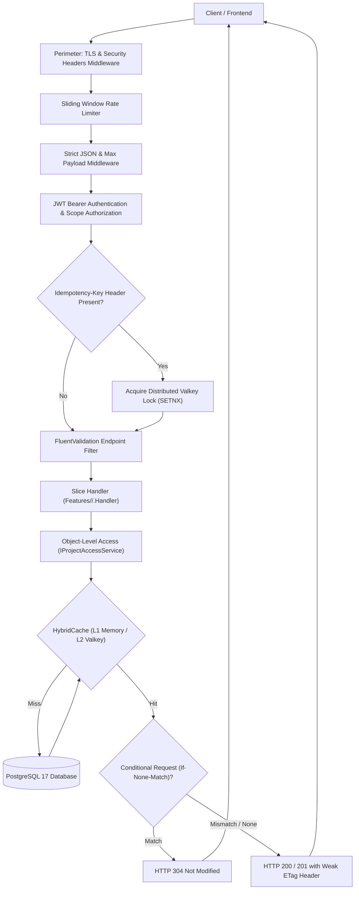
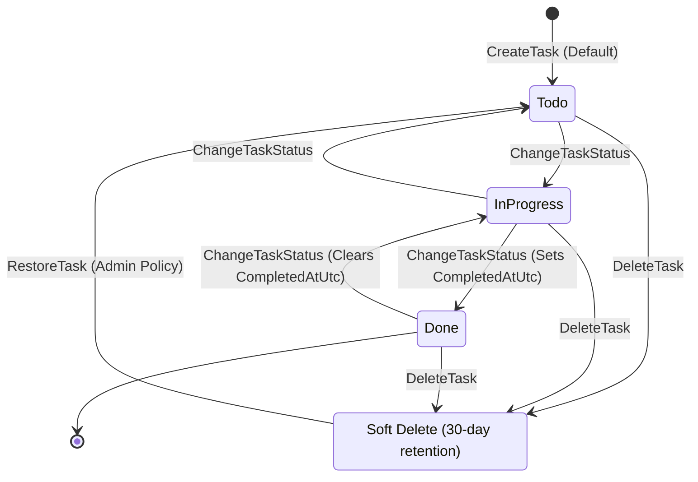

# TaskTracker API

> **The gold-standard reference implementation of Vertical Slice Architecture on .NET 10 (`net10.0` LTS) and C# 14.** Built with ASP.NET Core Minimal APIs, EF Core 10 (PostgreSQL), two-tier HybridCache with Valkey, and Testcontainers-driven automated testing.

[](https://github.com/behnamnouri/VerticalSliceMinimalApi/actions/workflows/ci.yml)
[](https://dotnet.microsoft.com/)
[](https://learn.microsoft.com/dotnet/csharp/)
[](https://www.postgresql.org/)
[](https://valkey.io/)
[](LICENSE)

---

## Design Stance

For simple to moderately complex service systems, **I choose Vertical Slice Architecture over Clean, Onion, or Hexagonal Architecture.** 

In traditional Clean Architecture, code is organized by technical layers: Domain, Application, Infrastructure, and Presentation. In practice, this introduces high friction: adding a simple field requires editing files across four separate projects. Code that changes together is placed as far apart as possible, and developers spend hours writing boilerplate—Command, Query, DTO, Repository, Mapping Profile, Interface—for operations that are fundamentally standard data manipulation.

In this repository, **the feature is the unit of change**. Each use case is an autonomous, self-contained slice located in a single file (`Features/<Feature>/<UseCase>.cs`) that talks to the `DbContext` directly:
- **No generic repositories or units of work:** EF Core's `DbContext` is already a unit of work, and `DbSet<T>` is already a repository.
- **No in-memory mediator libraries:** Direct dependency injection of typed handlers delivers compile-time safety, zero reflection overhead, and instant IDE navigation.
- **No reflection-based object mappers:** Explicit C# 14 record projections compile cleanly and generate optimal SQL queries.
- **No third-party endpoint frameworks:** Native Minimal APIs with lightweight assembly discovery provide raw speed and zero dependency bloat.

Shared code is kept deliberately minimal, governed by the "Rule of Three", and policed by automated architecture tests.

> 💡 **New to Vertical Slice Architecture?** Read the [Beginner's Guide (Junior to Senior)](docs/BEGINNERS-GUIDE.md) for conceptual fundamentals and the [Step-by-Step User Manual Walkthrough](docs/WALKTHROUGH.md) for hands-on execution.

---

## Architectural Workflow

### 1. Request Lifecycle Flow



### 2. Task State Machine Transitions



---

## Comprehensive Endpoint Matrix

| Method | Route | OAuth Scope | Project Role | Rate Limit Policy | HybridCache | Idempotency | Conditional Request |
| :--- | :--- | :--- | :--- | :--- | :--- | :--- | :--- |
| `POST` | `/api/v1/projects` | `tasks.write` | *(Creator)* | `policy-mutation` | Invalidation | Optional | — |
| `GET` | `/api/v1/projects` | `tasks.read` | Viewer | `policy-general` | — (Keyset) | — | — |
| `GET` | `/api/v1/projects/{id}` | `tasks.read` | Viewer | `policy-general` | L1 + L2 | — | Weak ETag (`If-None-Match`) |
| `PUT` | `/api/v1/projects/{id}` | `tasks.write` | Owner | `policy-mutation` | Invalidation | — | Concurrency (`If-Match`) |
| `POST` | `/api/v1/projects/{id}/archive` | `tasks.write` | Owner | `policy-mutation` | Invalidation | — | — |
| `POST` | `/api/v1/projects/{id}/unarchive` | `tasks.write` | Owner | `policy-mutation` | Invalidation | — | — |
| `GET` | `/api/v1/projects/{id}/summary` | `tasks.read` | Viewer | `policy-general` | L1 + L2 | — | — |
| `GET` | `/api/v1/projects/{id}/members` | `tasks.read` | Viewer | `policy-general` | — | — | — |
| `POST` | `/api/v1/projects/{id}/members` | `tasks.write` | Owner | `policy-mutation` | Invalidation | — | — |
| `PUT` | `/api/v1/projects/{id}/members/{uid}/role` | `tasks.write` | Owner | `policy-mutation` | Invalidation | — | Last-Owner Guard |
| `DELETE` | `/api/v1/projects/{id}/members/{uid}` | `tasks.write` | Owner / Self | `policy-mutation` | Invalidation | — | Last-Owner Guard |
| `POST` | `/api/v1/projects/{id}/tasks` | `tasks.write` | Editor | `policy-mutation` | Invalidation | Supported | — |
| `GET` | `/api/v1/projects/{id}/tasks` | `tasks.read` | Viewer | `policy-search` | — (Keyset/GIN) | — | — |
| `GET` | `/api/v1/tasks/{taskId}` | `tasks.read` | Viewer | `policy-general` | L1 + L2 | — | Weak ETag (`If-None-Match`) |
| `PUT` | `/api/v1/tasks/{taskId}` | `tasks.write` | Editor | `policy-mutation` | Invalidation | — | Concurrency (`If-Match`) |
| `POST` | `/api/v1/tasks/{taskId}/status` | `tasks.write` | Editor | `policy-mutation` | Invalidation | — | State Machine |
| `POST` | `/api/v1/tasks/{taskId}/assign` | `tasks.write` | Editor | `policy-mutation` | Invalidation | — | Membership Check |
| `DELETE` | `/api/v1/tasks/{taskId}` | `tasks.write` | Editor | `policy-mutation` | Invalidation | — | Soft Delete |
| `POST` | `/api/v1/tasks/{taskId}/restore` | `tasks.admin` | Owner | `policy-mutation` | Invalidation | — | Named Filter Bypass |
| `GET` | `/api/v1/tasks/{taskId}/comments` | `tasks.read` | Viewer | `policy-general` | — (Keyset) | — | — |
| `POST` | `/api/v1/tasks/{taskId}/comments` | `tasks.write` | Editor | `policy-mutation` | Invalidation | Supported | — |
| `DELETE` | `/api/v1/comments/{commentId}` | `tasks.write` | Author / Owner | `policy-mutation` | Invalidation | — | Ownership Guard |
| `GET` | `/api/v1/me` | `tasks.read` | *(Any)* | `policy-general` | — | — | — |
| `POST` | `/dev/token` | *(Public)* | *(Dev Only)* | `policy-auth` | — | — | Disabled in Prod |

---

## Decision Tree: "Where Does This Code Go?"

To preserve the autonomy of vertical slices while preventing chaotic code sprawl, I adhere to this decision tree:

1. **Is it domain logic, state transition validation, or business invariant rules?**  
   $\rightarrow$ Place inside `Domain/Entities/`, `Domain/Enums/`, or `Domain/Errors/`.
2. **Is it cross-cutting infrastructure required by all slices (e.g. Result monad, HTTP filters, authentication)?**  
   $\rightarrow$ Place inside `Common/` or `Infrastructure/`.
3. **Is it database schema, migrations, or EF Core interceptors?**  
   $\rightarrow$ Place inside `Persistence/`.
4. **Is it a helper function used in only 1 or 2 slices?**  
   $\rightarrow$ Keep it private inside the feature slice. Do NOT extract prematurely.
5. **Has the exact same logic been duplicated across 3 distinct slices (The Rule of Three)?**  
   $\rightarrow$ Extract to a focused service in `Common/Services/` and police with architecture tests.

---

## Local Development & Quick Start

### Prerequisites
- [.NET 10 SDK (`10.0.100` or newer)](https://dotnet.microsoft.com/)
- [Docker Desktop](https://www.docker.com/) (WSL2 backend recommended on Windows)

### 1. Initialize Local Secrets
Run the local setup script to generate ECDSA ES256 development signing keys:

```bash
# On Linux / macOS:
./scripts/init.sh

# On Windows (PowerShell):
./scripts/init.ps1
```

### 2. Launch the Stack via Docker Compose
Start PostgreSQL, Valkey, run database migrations, and launch the API:

```bash
docker compose up -d
```

Verify service health:
```bash
docker compose ps
curl http://localhost:8080/health/ready
```

### 3. Explore Interactive OpenAPI / Scalar Documentation
Open your browser to:
- **Scalar UI:** `http://localhost:8080/scalar/v1`
- **OpenAPI v3 Spec:** `http://localhost:8080/openapi/v1.json`

---

## CLI Commands

The API binary includes built-in CLI commands to support production migration workflows and local testing:

```bash
# Apply pending EF Core database migrations and exit:
dotnet run --project src/TaskTracker.Api -- --migrate

# Seed demo dataset (sample projects, members, tasks, comments):
dotnet run --project src/TaskTracker.Api -- --seed-demo

# Seed large-volume dataset for performance benchmarking:
dotnet run --project src/TaskTracker.Api -- --seed-perf

# Execute internal container health check probe (for chiseled distroless images):
dotnet run --project src/TaskTracker.Api -- --healthcheck
```

---

## Scaffolding a New Vertical Slice

To add a new use case following the project's anatomical conventions, run the slice generator script:

```bash
# On Linux / macOS:
./scripts/new-slice.sh Projects ExportProjects

# On Windows (PowerShell):
./scripts/new-slice.ps1 Projects ExportProjects
```

The script generates `src/TaskTracker.Api/Features/<Feature>/<UseCase>.cs` with pre-wired `Request`, `Response`, `Validator`, `Handler`, and `Endpoint` classes.

---

## Automated Test Suite

The test suite validates behavior, security boundaries, and architectural isolation across 4 distinct test projects:

```bash
dotnet test
```

### Test Suite Structure
1. **`TaskTracker.Tests.Unit` (35 tests):** Validates domain state machines, entity invariants, Result monad behavior, and FluentValidation rules in pure memory.
2. **`TaskTracker.Tests.Architecture` (10 tests):** Enforces slice isolation, dependency direction, repository absence, and query filter bypass allowlists using `NetArchTest.eXpect`.
3. **`TaskTracker.Tests.Integration` (25 tests):** Executes against genuine PostgreSQL 17 and Valkey 8.0 Testcontainers:
   - Keyset pagination and PostgreSQL full-text search (`tsvector` / GIN).
   - Distributed Valkey idempotency locks and replay mechanisms.
   - Dual-instance cache tag invalidation across distinct `CustomWebApplicationFactory` instances.
   - OWASP BOLA boundary enforcement and named query filter isolation.
4. **`OpenApiDriftTests`:** Ensures the committed OpenAPI contract (`docs/openapi/tasktracker.v1.json`) matches the live runtime schema.

---

## Performance Benchmarking

Benchmark results measured via `TaskTracker.LoadTool` against the containerized production stack (`api`, `postgres`, `valkey`):

| Scenario | Throughput | Median (p50) | 95th Percentile | 99th Percentile |
| :--- | :--- | :--- | :--- | :--- |
| **Mixed Workload (60% Read, 20% Search, 20% Write)** | **151.2 req/s** | **1.78 ms** | **19.85 ms** | **41.36 ms** |
| **Burst Rate-Limit Interception** | **2,032.8 req/s** | **3.70 ms** | **10.59 ms** | **27.06 ms** |

See [`docs/performance/results.md`](docs/performance/results.md) for full benchmark metrics and distribution graphs.

---

## Deliberate Scope Discipline (Non-Goals)

To maintain gold-standard quality and security, the following were deliberate non-goals:
- **No Frontend / UI:** This repository is strictly a production backend API showcase.
- **No Email / Notification Dispatch:** Avoids mocking non-core notification providers.
- **No File Attachments:** S3/Blob storage protocols add complexity unrelated to slice architecture.
- **No Real-Time WebSockets / SignalR:** Focuses entirely on high-performance HTTP REST semantics.
- **No Outbox / Distributed Message Bus:** Avoids distributed transactional messaging ceremony.
- **No Third-Party Identity Provider:** Uses a strictly guarded, local-only ECDSA token issuer for local development and testing.

---

## Architectural Documentation Index

- [Beginner's Guide: Understanding Vertical Slice Architecture](docs/BEGINNERS-GUIDE.md)
- [User Manual: End-to-End Walkthrough & API Testing](docs/WALKTHROUGH.md)
- [Architecture: Vertical Slices Deep Dive](docs/architecture/vertical-slices.md)
- [Architecture: Data Model & PostgreSQL Indexes](docs/architecture/data-model.md)
- [Architecture: HybridCache & Valkey Topology](docs/architecture/caching.md)
- [Security: OWASP API Security Top 10 Mitigations](docs/security/owasp-api-top10.md)
- [Security: STRIDE Threat Model](docs/security/threat-model.md)
- [API: Problem Details Error Catalog](docs/api/errors.md)
- [Operations: Production Runbook](docs/RUNBOOK.md)
- [Interview: 16 Senior Architectural Interview Q&A](docs/INTERVIEW-NOTES.md)
- [ADRs: Complete Architectural Decision Records (0001 - 0019)](docs/adr/)
