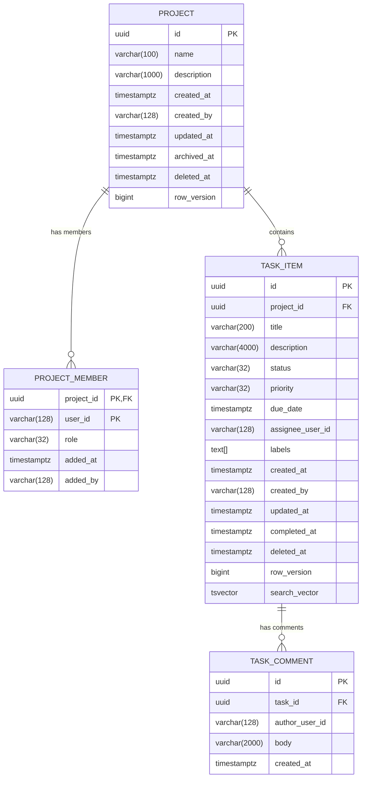

# Data Model & PostgreSQL Architecture

This document describes the relational schema, PostgreSQL-specific indexing strategies, and EF Core 10 mappings used in the Task Tracker API.

---

## Entity Relationship Overview



---

## Key Relational Design Principles

### 1. Sequential UUIDv7 Keys (`Guid.CreateVersion7()`)
Every primary key is a 128-bit sequential UUIDv7. Because the highest bits encode a millisecond Unix timestamp, keys insert monotonically at the right edge of PostgreSQL B-tree indexes, eliminating the severe page fragmentation associated with UUIDv4.

### 2. Native PostgreSQL String Arrays (`text[]`)
Labels are stored as native PostgreSQL arrays (`text[]`). EF Core maps these directly to `string[]`. This eliminates the need for a separate join table while enabling lightning-fast array containment queries (`@>`) backed by a Generalized Inverted Index (`GIN`):
```csharp
builder.Property(t => t.Labels).HasColumnType("text[]");
builder.HasIndex(t => t.Labels).HasMethod("gin");
```

### 3. Generated Full-Text Search Vectors (`tsvector`)
Rather than relying on runtime concatenation or external search clusters, tasks utilize a generated, stored `tsvector` column:
```sql
search_vector tsvector GENERATED ALWAYS AS (
    to_tsvector('english', coalesce(title, '') || ' ' || coalesce(description, ''))
) STORED
```
Indexed with a dedicated GIN index, queries use `EF.Functions.WebSearchToTsQuery("english", query)` for sub-millisecond full-text searches.

### 4. Partial Indexes for Active Records
Indexes for keyset pagination and filtering include `WHERE deleted_at IS NULL` filter clauses:
```sql
CREATE INDEX ix_task_items_project_created_active 
ON task_items (project_id, created_at DESC, id DESC) 
WHERE deleted_at IS NULL;
```
This reduces index size and ensures soft-deleted records never degrade pagination performance.

### 5. Application-Managed Concurrency Tokens (`row_version`)
Each mutable entity includes an unsigned integer `row_version` column. It is configured in EF Core as `IsConcurrencyToken()` and incremented automatically by `AuditTimestampInterceptor` upon modification, driving HTTP weak ETags and preventing lost updates.
