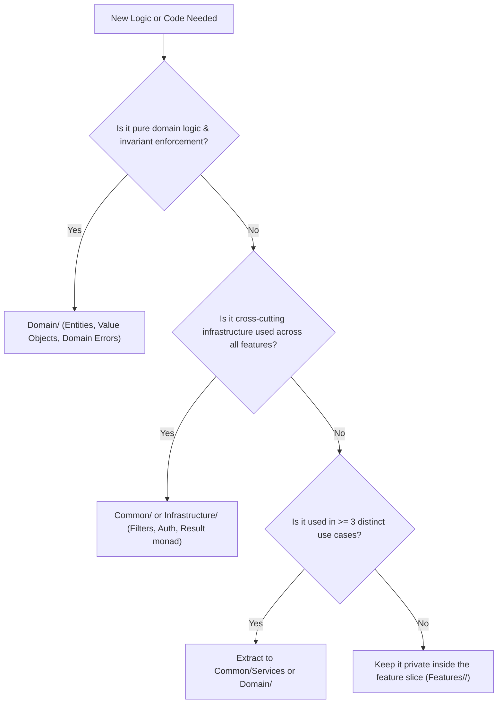

# Vertical Slice Architecture Deep Dive

This document details the architectural principles, structural rules, and design choices governing the Task Tracker API reference implementation.

---

## The Philosophy of Vertical Slices

In traditional Clean or Layered Architecture, code is organized by technical function:
- All controllers in one folder.
- All use cases or command handlers in another folder.
- All repositories in another.
- All domain entities in another.

This creates high horizontal coupling. Adding a single field to a use case requires editing 4+ projects across 4+ layers. 

In **Vertical Slice Architecture**, the codebase is divided along business capability lines. Each use case is treated as an autonomous slice that cuts vertically across all technical concerns:

```
[ HTTP Route / Minimal API Endpoint ]
                ↓
    [ FluentValidation Validator ]
                ↓
      [ Slice Request / Response ]
                ↓
         [ Slice Handler ]
                ↓
      [ AppDbContext / EF Core ]
                ↓
          [ PostgreSQL ]
```

---

## Anatomy of a Slice

Each use case lives in a single file (`Features/<Feature>/<UseCase>.cs`) as a `public static class` containing five tightly coupled types:

```csharp
public static class CreateTask
{
    // 1. Immutable Request Record
    public sealed record Request(Guid ProjectId, string Title, ...);

    // 2. Strongly Typed Response Record
    public sealed record Response(Guid Id, Guid ProjectId, ...);

    // 3. Request Validator (FluentValidation)
    public sealed class Validator : AbstractValidator<Request>
    {
        public Validator()
        {
            RuleFor(x => x.Title).NotEmpty().MaximumLength(200);
            ...
        }
    }

    // 4. Autonomous Handler
    public sealed class Handler(AppDbContext db, ICurrentUser currentUser, IProjectAccessService projectAccess)
    {
        public async Task<Result<Response>> HandleAsync(Request request, CancellationToken ct)
        {
            // Business logic, domain invariants, DB operations
        }
    }

    // 5. Endpoint Definition (Minimal API)
    public sealed class Endpoint : IEndpoint
    {
        public void MapEndpoint(IEndpointRouteBuilder app)
        {
            app.MapPost("/projects/{projectId:guid}/tasks", async (...) => { ... })
               .RequireAuthorization(AuthorizationPolicies.TasksWrite)
               .RequireRateLimiting(RateLimitingExtensions.MutationPolicy);
        }
    }
}
```

---

## Isolation Rules (Policed by Architecture Tests)

To prevent vertical slices from devolving into an unstructured monolith, strict architectural boundaries are enforced:

1. **Slice Independence:** Slice A may NEVER depend on or reference Slice B. Each slice must be independently understandable, testable, and deletable.
2. **Domain Layer Purity:** The `Domain` namespace depends on nothing outside itself. Entities enforce business invariants and state machines.
3. **Common Layer Independence:** The `Common` namespace never references `Features`.
4. **No Repository Interfaces:** Slices query and mutate via `AppDbContext` directly. No `*Repository` types are permitted.
5. **No Mediator Libraries:** Endpoints invoke their nested `Handler` directly through standard dependency injection.
6. **No Object Mapping Libraries:** Explicit C# 14 record construction and LINQ `.Select()` projections replace AutoMapper and Mapster.
7. **No Blocking Calls:** Methods must use async/await; `.Result` and `.GetAwaiter().GetResult()` are strictly forbidden.
8. **Allowlisted Query Filter Bypasses:** `.IgnoreQueryFilters()` is permitted only in allowlisted administrative slices (`RestoreTask`) and background purge jobs (`SoftDeletePurgeService`), each documented and verified by architecture tests.

---

## The Rule of Three & Code Placement Decision Tree

Duplication across slices is not an anti-pattern—it is often preferable to the wrong abstraction. When similar logic emerges across slices, I apply the **Rule of Three**:

> "Do not extract shared code until it is independently needed by at least three distinct use cases."

### Decision Tree: Where Does This Code Go?


