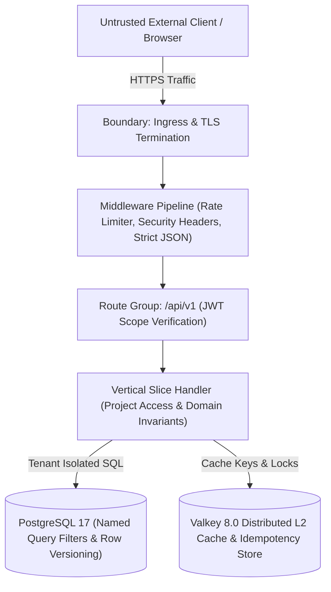

# Threat Model (STRIDE Methodology)

This document presents the STRIDE threat analysis for the Task Tracker API reference architecture.

---

## Trust Boundaries & Data Flow Diagram

---

## STRIDE Threat Analysis

### 1. Spoofing
- **Threat:** An attacker crafts or modifies a JWT token to impersonate another user.
- **Controls:**
  - Strict asymmetric/symmetric signature verification using standard ASP.NET Core JWT bearer authentication.
  - Development token issuer (`POST /dev/token`) is strictly disabled in production via configuration validation and rate-limited in local environments.

### 2. Tampering
- **Threat:** An attacker intercepts and modifies in-flight requests or attempts lost-update race conditions.
- **Controls:**
  - TLS encryption across all network boundaries.
  - Strict JSON validation prevents unknown property injection (mass assignment).
  - Optimistic concurrency with `If-Match` headers and `row_version` tokens ensures concurrent modifications fail cleanly (`412 Precondition Failed` or `409 Conflict`).
  - Idempotency filters verify request SHA-256 payload hashes against cached keys, rejecting tampered retries with `422 Unprocessable Content`.

### 3. Repudiation
- **Threat:** A user claims they did not create, modify, or delete a task or project.
- **Controls:**
  - Entity configurations audit `created_by`, `created_at`, `updated_at`, and `added_by` automatically via `AuditTimestampInterceptor`.
  - Immutable task comments preserve the original `author_user_id` and timestamp.
  - OpenTelemetry semantic tracing correlates every database change with the authenticated `sub` user identifier.

### 4. Information Disclosure
- **Threat:** An attacker probes IDs to discover project existence, inspect tasks belonging to other organizations, or read stack traces.
- **Controls:**
  - IDs are 128-bit sequential UUIDv7 (non-guessable, non-sequential integer enumeration).
  - When a user accesses an unauthorized project, the handler returns **`404 Not Found`** rather than `403 Forbidden`, concealing project existence.
  - EF Core named query filters (`SoftDelete`, `Membership`) block cross-tenant leakage even if a slice handler fails to append where clauses.
  - RFC 9457 Problem Details envelopes ensure zero stack traces or SQL details are exposed to clients.

### 5. Denial of Service (DoS)
- **Threat:** Squeezing CPU/memory via massive payloads, infinite pagination, or cache stampedes.
- **Controls:**
  - Request body limits (1 MB) and execution timeouts (30s).
  - Keyset cursor pagination caps page size at 100 items and eliminates quadratic `OFFSET` query costs.
  - Multi-tier sliding-window rate limiters throttle abuse.
  - `HybridCache` request coalescing prevents cache stampedes from exhausting PostgreSQL connection pools.

### 6. Elevation of Privilege
- **Threat:** A standard project member attempts to promote their role to `Owner` or delete the project.
- **Controls:**
  - Handlers verify explicit project roles (`Viewer`, `Editor`, `Owner`).
  - `UpdateMemberRole` and `RemoveMember` enforce last-owner domain invariants: a project can never be left without an active `Owner`.
  - Administrative restoration requires the `tasks.admin` OAuth scope.
